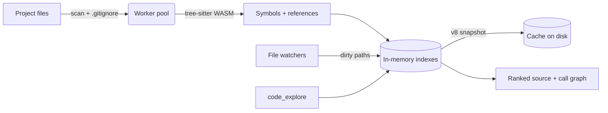

<div align="center">

# LatentContext

**Session memory, a knowledge graph, and a live code index for any MCP host.**

[](https://github.com/Master0fFate/LatentContext-MCP/actions/workflows/ci.yml)
[](https://www.npmjs.com/package/latentcontext-mcp)
[](https://nodejs.org)
[](LICENSE)


[Quick start](#quick-start) ·
[Code intelligence](#code-intelligence) ·
[Memory](#memory) ·
[Host setup](#host-setup) ·
[Configuration](#configuration) ·
[Development](#development)

</div>

---

LatentContext is a local [Model Context Protocol](https://modelcontextprotocol.io/) server. It gives an assistant two things it normally lacks:

- **A memory** that survives the context window: notes, session summaries, a knowledge graph, and optional local embeddings in SQLite.
- **A map of your code**: a tree-sitter index of every symbol, call, and reference in the project, kept fresh by file watchers and answered in one tool call.

Everything runs in-process over stdio. No database server, no native build step, no API keys, and no child processes per tool call.

## Highlights

| | |
| --- | --- |
| 🧭 **One-call code exploration** | `code_explore` takes symbol names, file names, or a plain question and returns line-numbered source, call paths, references, callees, and impact. |
| ⚡ **Built for speed** | Parsing and scanning run on a worker-thread pool. Results live in in-memory indexes. A compact v8 snapshot makes restarts near-instant. |
| 🔄 **Always current** | Native recursive watchers on Windows and macOS, per-directory watchers on Linux. Only changed files are re-parsed. |
| 🪟 **Quiet on Windows** | Tool calls spawn no processes, so no console windows flash. Worker threads do all the heavy work. |
| 🌍 **19 languages** | TypeScript, TSX, JavaScript, Python, Rust, Go, Java, C#, C, C++, Ruby, PHP, Kotlin, Scala, Lua, Zig, Elixir, Bash, PowerShell. |
| 🧠 **Session memory** | Tiered working memory, compression, a knowledge graph, and semantic retrieval within a token budget. |
| 🔌 **Works everywhere** | Portable JSON Schema, tool annotations, output schemas, and server instructions for Claude Code, Claude Desktop, Cursor, VS Code, Windsurf, Codex CLI, Gemini CLI, and more. |

## Quick start

```bash
npx -y latentcontext-mcp@latest
```

Most hosts take the same block:

```json
{
  "mcpServers": {
    "latentcontext": {
      "command": "npx",
      "args": ["-y", "latentcontext-mcp@latest"]
    }
  }
}
```

> [!TIP]
> For faster starts, install globally with `npm install -g latentcontext-mcp` and use `"command": "latentcontext-mcp"`.

Restart the host after you change its configuration. Requires **Node.js 20 or later**.

## Code intelligence

### `code_explore`

Ask in whatever form is natural. The tool finds the right symbols and returns their verbatim source with line numbers, so the model can edit from it directly.

```text
code_explore { "query": "how does createServer register tools" }
code_explore { "query": "UserService.load handleRequest" }
code_explore { "query": "src/server.ts" }
```

| Argument | Default | Purpose |
| --- | --- | --- |
| `query` | required | Symbol names, `Owner.member`, file names, or a question. |
| `root` | client roots | Absolute project directory, to explore a project other than the current one. |
| `max_files` | `10` | Maximum files whose source is included. |
| `token_budget` | `8000` | Upper bound on response size. |

A real response for `"referencesTo resolveRef"` on this repository, trimmed for length:

```text
27 files, 495 symbols indexed.

## src/code-explore.ts
function resolveRef L91-105 · function referencesTo L107-113
91	export function resolveRef(ref: CodeRef): CodeSymbol[] {
92	    const defs = ref.file.index.defsByName.get(ref.name);
93	    if (!defs) return [];
94	    if (defs.size === 1) return [...defs];
⋮
107	function referencesTo(symbol: CodeSymbol): CodeRef[] {
108	    const refs = symbol.file.index.refsByName.get(symbol.name);
109	    if (!refs) return [];
110	    const result: CodeRef[] = [];
111	    for (const ref of refs) if (ref.from !== symbol && resolveRef(ref).includes(symbol)) result.push(ref);
112	    return result.sort((a, b) => Number(b.kind === "call") - Number(a.kind === "call"));
113	}

## Call paths
referencesTo → resolveRef

## References and calls
resolveRef ← referencesTo src/code-explore.ts:111, callees src/code-explore.ts:120
resolveRef → directoryOf src/code-explore.ts:87
referencesTo ← impactOf src/code-explore.ts:212, explore src/code-explore.ts:376

## Impact
6 symbols in 2 files reach resolveRef within 3 hops.
```

### Performance

Measured on Windows 10 with Node.js 24:

| Workload | Files | Symbols | Cold index | Restart from cache | Warm query |
| --- | ---: | ---: | ---: | ---: | ---: |
| Rust + TypeScript app | 715 | 23,341 | 1.3 s | 0.4 s | 9–92 ms |
| Folder of 40+ projects | 8,080 | 136,807 | 4.9 s | — | 92 ms |

An edit is visible on the next call, typically within a few milliseconds.

### How it works



1. **Scan.** A worker walks the project, honours nested `.gitignore` files, and skips dependency and build caches such as `node_modules`, `.venv`, and `.next`.
2. **Parse.** Changed files are parsed in parallel by up to eight worker threads. Each language has its own query for definitions, calls, inheritance, imports, and type references.
3. **Index.** Symbols land in hash maps keyed by exact name, by sub-word (`loadUserProfile` → `load`, `user`, `profile`), and by reference name. Updates are incremental per file.
4. **Rank.** Queries are scored by exact and owner-qualified name hits, case-folded matches, IDF-weighted sub-words, prefixes, and file paths.
5. **Connect.** The top matches are linked by a bounded breadth-first search over the call graph. Intermediate functions on a path are pulled into the result.
6. **Render.** Source is read fresh from disk, merged into line ranges, and trimmed to the token budget. Large classes are shown as an outline of their members.

### Freshness

| Platform | Watcher | On change |
| --- | --- | --- |
| Windows, macOS | One native recursive watcher | Re-parse only the touched files |
| Linux | One watcher per indexed directory | Re-parse only the touched files |
| Any, if watching fails | None | Fast full rescan in a worker before each query |

A `.gitignore` edit or a large burst of changes, such as a branch switch, triggers one rescan. The index persists to `<data dir>/code-index/` and is reused on the next start.

### Supported languages

| Language | Extensions |
| --- | --- |
| TypeScript / TSX | `.ts` `.mts` `.cts` `.tsx` |
| JavaScript | `.js` `.mjs` `.cjs` `.jsx` |
| Python | `.py` `.pyi` |
| Rust | `.rs` |
| Go | `.go` |
| Java | `.java` |
| C# | `.cs` |
| C / C++ | `.c` · `.cc` `.cpp` `.cxx` `.h` `.hh` `.hpp` `.hxx` `.ino` |
| Ruby | `.rb` `.rake` |
| PHP | `.php` |
| Kotlin | `.kt` `.kts` |
| Scala | `.scala` `.sc` |
| Lua | `.lua` |
| Zig | `.zig` |
| Elixir | `.ex` `.exs` |
| Bash | `.sh` `.bash` |
| PowerShell | `.ps1` `.psm1` |

### Choosing the project

The project to index is picked in this order:

1. The `root` argument of the call.
2. `LATENTCONTEXT_CODE_ROOT` (several paths may be joined with the platform path delimiter).
3. The roots the MCP client reports.
4. The server's working directory, if it looks like a project (`.git`, `package.json`, `Cargo.toml`, `go.mod`, `pyproject.toml`, and similar).

The home directory and drive roots are never indexed.

## Memory

| Tool | Use | Annotations |
| --- | --- | --- |
| `session_start` | Start a session; any active session is archived first. | |
| `memory_store` | Record a note, decision, fact, or event for the active session. | |
| `memory_retrieve` | Retrieve relevant session context within a token budget. | read-only |
| `memory_compress` | Compress working memory or summaries (lossy). | destructive |
| `memory_forget` | Deprecate, correct, or remove a memory. | destructive, idempotent |
| `memory_status` | Report current storage and session statistics. | read-only |

Stored notes need at least 10 words; 25 or more are recommended. Working memory is isolated by session ID, and it is archived when a session changes or the server shuts down.

`session_start`, `memory_store`, `memory_retrieve`, `memory_status`, and `code_explore` return `structuredContent` that matches a published `outputSchema`.

<details>
<summary><b>Resources and prompts</b></summary>

| URI | Content |
| --- | --- |
| `memory://core` | Persistent Tier 3 core memories. |
| `memory://session/current` | Working memory for the active session. |
| `memory://graph/schema` | Entity types and relation predicates (JSON). |
| `memory://stats` | Storage statistics (JSON). |

`extract_facts`, `compress_session`, and `consolidate_epoch` are prompt templates. They turn text into fact triples, summarize working memory, and merge session summaries.
</details>

## Host setup

<details>
<summary><b>Claude Code</b></summary>

```bash
claude mcp add latentcontext --scope user -- npx -y latentcontext-mcp@latest
```

Use `--scope project` to share the configuration through `.mcp.json`.
</details>

<details>
<summary><b>Claude Desktop</b></summary>

Add the `mcpServers` block from [Quick start](#quick-start) to `claude_desktop_config.json` (Settings → Developer → Edit Config).
</details>

<details>
<summary><b>Cursor</b></summary>

Add the `mcpServers` block to `.cursor/mcp.json` in the project, or to `~/.cursor/mcp.json` for all projects.
</details>

<details>
<summary><b>VS Code (GitHub Copilot)</b></summary>

Create `.vscode/mcp.json`:

```json
{
  "servers": {
    "latentcontext": {
      "type": "stdio",
      "command": "npx",
      "args": ["-y", "latentcontext-mcp@latest"]
    }
  }
}
```
</details>

<details>
<summary><b>Windsurf</b></summary>

Add the `mcpServers` block to `~/.codeium/windsurf/mcp_config.json`.
</details>

<details>
<summary><b>Codex CLI</b></summary>

Add to `~/.codex/config.toml`:

```toml
[mcp_servers.latentcontext]
command = "npx"
args = ["-y", "latentcontext-mcp@latest"]
```
</details>

<details>
<summary><b>Gemini CLI</b></summary>

Add the `mcpServers` block to `~/.gemini/settings.json`, or to `.gemini/settings.json` in the project.
</details>

## Configuration

### Environment variables

| Variable | Effect |
| --- | --- |
| `LATENTCONTEXT_CODE_ROOT` | Project directory (or directories) for `code_explore`. Overrides client roots. |
| `LATENTCONTEXT_CODE_INDEX` | Set to `0` or `off` to disable the code index and hide `code_explore`. |
| `LATENTCONTEXT_DATA_DIR` | Directory for `memory.db`, `server.log`, and `code-index/`. Overrides every other storage setting. |
| `LATENTCONTEXT_CONFIG` | Path to a `latentcontext.config.json` to load. |
| `LATENTCONTEXT_ALLOW_PROJECT_CONFIG` | Set to `1` to also read `latentcontext.config.json` from the launched project. |
| `LATENTCONTEXT_HIDE_CONSOLE` | Windows only. Set to `0` to keep the console window visible. |

### Storage

Runtime state is project-local by default:

```text
<launched-project>/.latentcontext/
├── .gitignore      # "*" so the folder never reaches git
├── memory.db
├── server.log
└── code-index/
```

`<launched-project>` is the working directory of the server process. The folder ignores itself, so no repository needs a `.gitignore` entry for it. To share memory across projects, set `LATENTCONTEXT_DATA_DIR`:

```json
{
  "mcpServers": {
    "latentcontext": {
      "command": "latentcontext-mcp",
      "env": { "LATENTCONTEXT_DATA_DIR": "C:/shared/latentcontext" }
    }
  }
}
```

<details>
<summary><b>Configuration file</b></summary>

Point `LATENTCONTEXT_CONFIG` at a JSON file:

```json
{
  "storage": { "dataDir": "./shared-state", "sqliteFile": "memory.db" },
  "embedding": { "provider": "local" }
}
```

A relative `storage.dataDir` resolves against the configuration file. The server also reads `latentcontext.config.json` from the default data directory or beside the installed package. A `latentcontext.config.json` in the launched project is ignored unless `LATENTCONTEXT_ALLOW_PROJECT_CONFIG=1` is set. Use `"provider": "none"` to disable embeddings.
</details>

### Logging

Diagnostics go to `server.log` in the data directory. After the MCP handshake, records at `info` and above are also sent as `notifications/message` with logger `latentcontext`. Clients can change the threshold with `logging/setLevel`. Stdout carries only protocol frames, and nothing is written to stderr.

## Development

```bash
git clone https://github.com/Master0fFate/LatentContext-MCP.git
cd LatentContext-MCP
npm install
npm run build
```

| Script | Purpose |
| --- | --- |
| `npm run build` | Compile TypeScript and prepare the executable. |
| `npm run dev` | Run the TypeScript source directly. |
| `npm run typecheck` | Type-check sources, tests, and benchmarks. |
| `npm test` | Run the full suite over real stdio. |
| `npm run test:smoke` | Pack, install, and exercise the packaged server. |
| `npm run check` | `typecheck` + `test`. |
| `npm run audit:production` | Audit production dependencies. |
| `npm run benchmark:retrieval` | Benchmark memory retrieval. |

To run a local build from a host, point it at the entry point:

```json
{
  "mcpServers": {
    "latentcontext": {
      "command": "node",
      "args": ["/absolute/path/to/LatentContext-MCP/dist/index.js"]
    }
  }
}
```

CI runs on Linux, macOS, and Windows with Node.js 20, 22, and 24.

> [!NOTE]
> If `npm install` fails while `onnxruntime-node` downloads optional CUDA binaries (Linux x64 only), set `ONNXRUNTIME_NODE_INSTALL_CUDA=skip`. The server does not use them.

<details>
<summary><b>Grammar sources</b></summary>

Grammars for TypeScript, TSX, JavaScript, Python, Rust, Go, Java, C#, C++, Ruby, PHP, Bash, and PowerShell come from [`@vscode/tree-sitter-wasm`](https://github.com/microsoft/vscode-tree-sitter-wasm). The C, Kotlin, Scala, Lua, Zig, and Elixir grammars in [`grammars/`](grammars) are the prebuilt WebAssembly files published with `tree-sitter-c` 0.24.1, `@tree-sitter-grammars/tree-sitter-kotlin` 1.1.0, `tree-sitter-scala` 0.24.0, `@tree-sitter-grammars/tree-sitter-lua` 0.4.1, `@tree-sitter-grammars/tree-sitter-zig` 1.1.2, and `tree-sitter-elixir` 0.3.5.
</details>

## License

[MIT](LICENSE)
